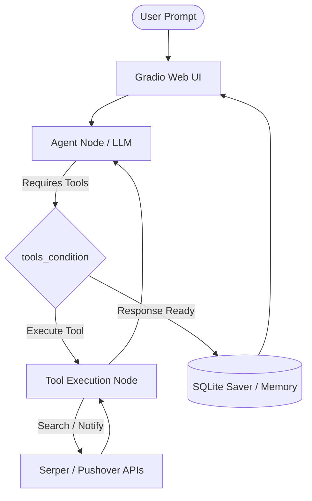

# LangGraph Practice & Lab

[](https://www.python.org/)
[](https://langchain-ai.github.io/langgraph/)
[](https://gradio.app/)
[](https://opensource.org/licenses/MIT)

A comprehensive hands-on guide and lab for building stateful AI agent workflows using **[LangGraph](https://langchain-ai.github.io/langgraph/)**. This repository covers the complete journey from basic node graphs to an autonomous agent powered by **Groq**, integrated tool calling (Serper Web Search & Pushover Notifications), persistent SQLite memory checkpointing, time-travel capabilities, and an interactive **Gradio** web user interface.

---

## Key Features & Capabilities

- **StateGraph Core Mechanics**: Defining custom state schemas, nodes, conditional edges, and execution flows.
- **High-Performance Inference**: Powered by `ChatGroq` (`llama-3.3-70b-versatile` / `llama3-8b-8192`).
- **Autonomous Tool Calling**: Dynamic routing using `ToolNode` and `tools_condition` for:
  - **Web Search**: Real-time web querying via Serper API.
  - **Push Notifications**: Mobile and desktop alerts via Pushover API.
- **Dual Checkpointing & Memory Systems**:
  - `MemorySaver`: In-memory conversation state persistence for rapid testing.
  - `SqliteSaver`: Database-backed persistent checkpointing saved to `memory.db`.
- **Time Travel & State Branching**: Inspecting historical state snapshots, replaying execution graphs, and branching from past checkpoints.
- **Interactive Gradio UI**: Browser-based chat interface to interact with the agent and observe state persistence.

---

## Architecture & Workflow



---

## Repository Structure

| File / Directory | Description |
|---|---|
| `LangGraph_Lab.ipynb` | Interactive Jupyter notebook containing all modules and step-by-step code |
| `req.txt` | Python dependencies required for the project |
| `.env` | Environment variables for API keys (Groq, Serper, Pushover) |
| `memory.db` | SQLite database storing persistent conversation checkpoints |
| `README.md` | Project documentation and setup guide |

---

## Quickstart Guide

### 1. Prerequisites
- **Python 3.12+** installed on your machine.
- API keys for the following services:
  - [Groq Console](https://console.groq.com)
  - [Serper Dev](https://serper.dev)
  - [Pushover](https://pushover.net)

### 2. Environment Setup

Clone the repository and set up a Python virtual environment:

```bash
# Create a virtual environment
python -m venv .venv

# Activate the virtual environment
# Linux / macOS:
source .venv/bin/activate
# Windows:
# .venv\Scripts\activate

# Install dependencies
pip install -r req.txt
```

### 3. Configure Credentials

Create a `.env` file in the root directory of the project:

```env
GROQ_API_KEY=your_groq_api_key_here
SERPER_API_KEY=your_serper_api_key_here
PUSHOVER_USER=your_pushover_user_key_here
PUSHOVER_TOKEN=your_pushover_app_token_here
```

---

## Execution & Usage

Launch Jupyter Notebook to run through the laboratory exercises:

```bash
jupyter notebook LangGraph_Lab.ipynb
```

### Notebook Modules Overview

1. **Silly Graph** — Minimal single-node graph validating execution flow and state pass-through.
2. **Chatbot** — Integrating `ChatGroq` for direct streaming model responses.
3. **Tool Agent** — Binding web search (`Serper`) and notification (`Pushover`) tools to the agent.
4. **In-Memory History** — Implementing `MemorySaver` for multi-turn conversation memory.
5. **Persistent SQLite Store** — Utilizing `SqliteSaver` to preserve checkpoints across sessions.
6. **State Snapshot Inspection** — Browsing and analyzing saved checkpoint states.
7. **Time Travel** — Rewinding state execution, modifying past inputs, and branching new paths.
8. **Gradio UI** — Launching the local web application for chatting with the agent.

---

## License

This project is licensed under the MIT License.

